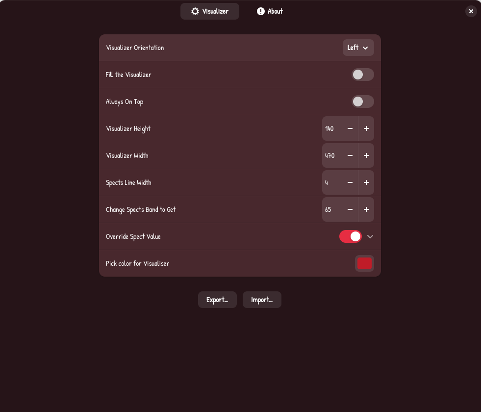
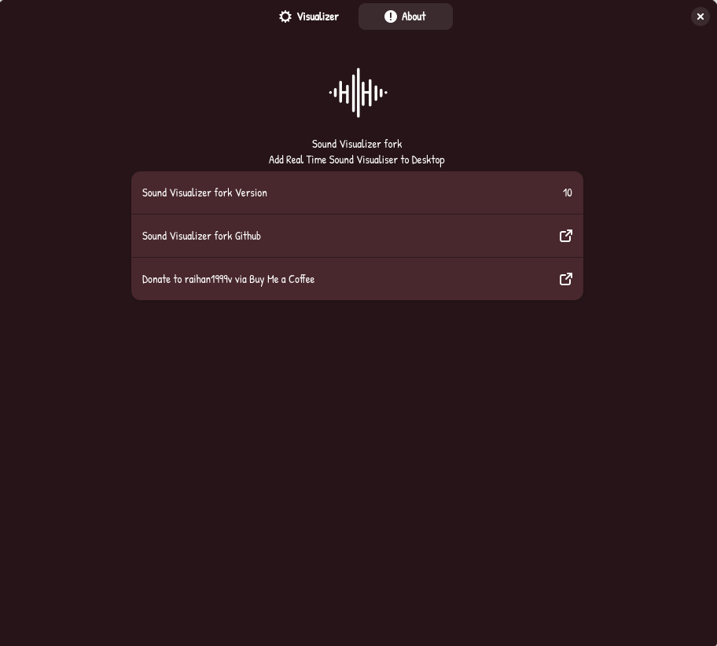

# Sound Visualizer ported to recent GNOME versions

> Supported GNOME versions: 45, 46, 47, 48, 49, 50, 51

> [!CAUTION]
> **Work In Progress:** This fork is currently under development. It is not yet stable or finished. Expect bugs and frequent updates!

> Current extension experimental version : 10

# Sound Visualizer
A Sound Visualizer for GNOME Shell based on GStreamer, specifically for Wayland.


For desktop widgets, I'm using the [Circular Widgets](https://extensions.gnome.org/extension/5530/circular-widgets/) extension.


<p align="center">
  
  
  
</p>


# Original Features

| Feature | Status |
|---|---|
| Drag and drop support | ✅ Available |
| Change audio source from the menu (Right/left click on the visualizer to change) | ❌Removed | 
| Change visualizer size | ✅ Available |
| Increase or decrease bands | ✅ Available |
| Choose how many bands will appear on display | ✅ Available | 
| Flip the visualizer | ❌Removed |
| Keep the visualizer always on top | ✅ Available |
| Change the visualizer color | ✅ Available |
| Change the visualizer style from bar to solid color | ✅ Available |

# Fork Features

| Feature | Status |
|---|---|
| Import and export settings | ✅ Available |
| Visualizer orientation | ✅ Available |
| Hide the visualizer when audio is silent | ✅ Available |
| Pause audio analysis for fullscreen or maximized windows on the visualizer's screen | ✅ Available |
| Bars, filled curve, or line style, with an optional symmetric mode | ✅ Available |
| Single colour, gradient, or album-cover colours | ✅ Available (experimental) |
| Logarithmic frequency scale | ✅ Available (experimental) |
| Controls for refresh rate, smoothing, fall speed, sensitivity, and silence threshold | ✅ Available |
| Customizable glow effect | ✅ Available (experimental) |
| Retry audio capture automatically after errors | ✅ Available |

More features will be added in the future!

# Installation

**Option 1: From ZIP**
1. Download the zip file: https://github.com/Valrunch/Sound-Visualizer-fork/archive/refs/heads/main.zip
2. Extract the zip file and open the extracted folder in your terminal.
3. Run `make install`

**Option 2: From Git**
```bash
git clone https://github.com/Valrunch/Sound-Visualizer-fork.git
cd Sound-Visualizer-fork
make install
```

# Acknowledgements & Credits

**This project is a patched version of the original [Visualizer](https://github.com/raihan2000/visualizer) created by "raihan2000".**

**Full credit for the original source code goes to the original author.**

This fork was created to update the codebase, add a few new features, ensure full compatibility with recent GNOME releases, and just to enjoy working on it.

This extension is also inspired by [Glava](https://github.com/jarcode-foss/glava).

Licensed under the [GPL-3.0 License](LICENSE) (same as the original project).
